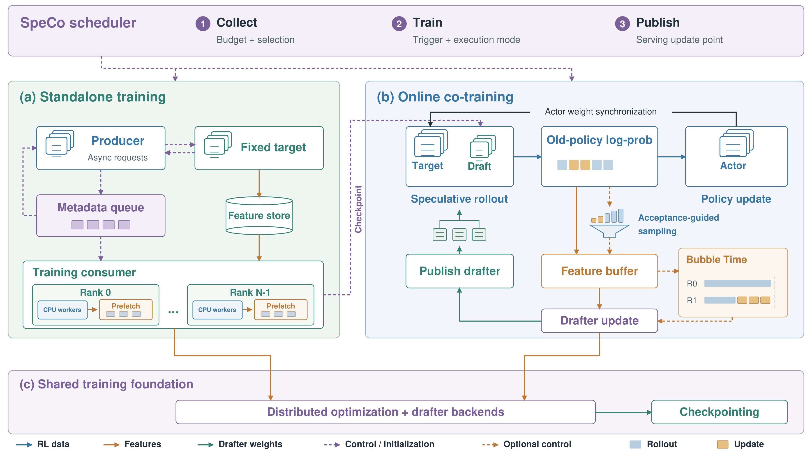
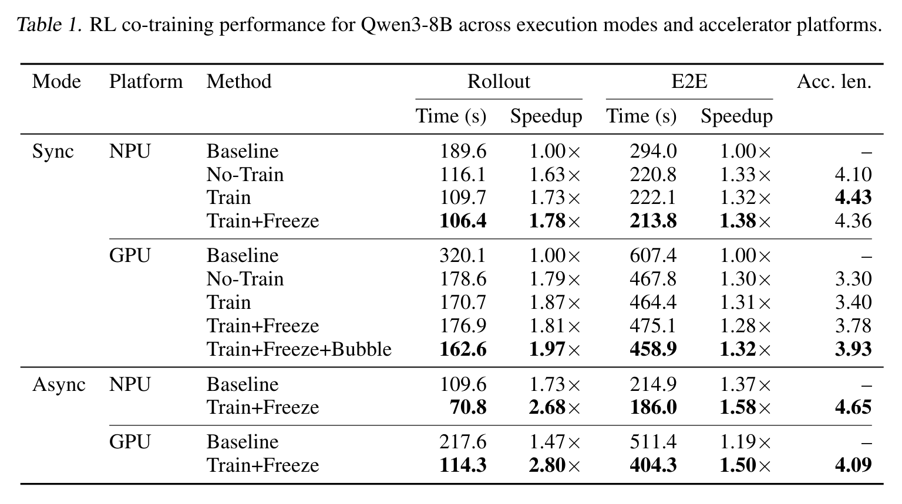
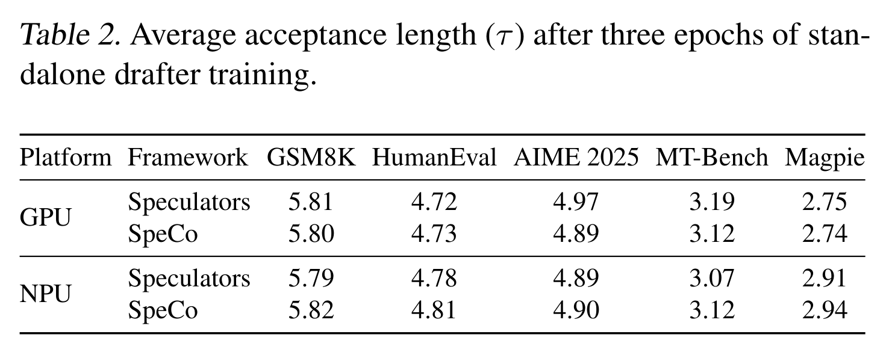

  

<h3 align="center">verl-SpeCo: A Unified Training System for Speculative Drafters</h3>

  <a href="#getting-started">Quickstart</a> · <a href="#hardware-support">Hardware Support</a> · <a href="#co-training-results">Benchmarks</a> · <a href="docs/usage.md">Documentation</a> · <a href="https://verl-project.github.io/posts/2026-11-16-verl-speco-v0-2-0/">Blog</a> · <a href="https://github.com/verl-project/verl-SpeCo/releases">Releases</a> · <a href="#community--contributing">Developer Slack</a>

SpeCo keeps speculative drafters aligned with evolving RL policies. It reuses
training features, adapts the drafter online, and hot-updates rollout engines
without restarting the RL job. Built as an import-only extension of
[verl](https://github.com/verl-project/verl), it leaves upstream verl unmodified.
Standalone training can also produce a deployable drafter or initialize co-training.

In the Qwen3-8B + DSpark evaluation, async Train+Freeze achieved **1.50× GPU**
and **1.58× Ascend NPU** end-to-end step speedup against each platform's
synchronous baseline without speculative decoding. [See the comparison](#co-training-results).

## Key Features

- **Online adaptation:** reuse rollout responses and old-policy features; train from current data or replay, then safely publish drafter weights.
- **Acceptance-guided control:** mix hard and uniform samples, and pause/resume updates as adaptation gains change.
- **Flexible execution:** synchronous and asynchronous co-training; optional Bubble Time moves optimizer work into rollout-idle windows. Bubble Time currently requires the legacy trainer.
- **Extensible infrastructure:** EAGLE-1/2/3, DFlash/DFlash2, DSpark, Domino, and P-EAGLE training backends, with backend-specific rollout support on GPU/NPU.
- **Standalone training:** independently generate features and train deployable drafters using shared training infrastructure.
- **Hardware portability:** CUDA GPU and Ascend NPU paths for co-training and standalone training; availability depends on the drafter and serving runtime.

## Architecture

The scheduler coordinates **collect → train → publish**. Online co-training
captures target features, performs distributed drafter updates, and publishes
successful weights at rollout-safe points. Standalone and online workflows
share training backends and checkpointing.

[Scheduler guide](docs/drafter_scheduler.md) · [Bubble Time guide](docs/bubble_time_drafter_training.md)

## Co-Training Results

Paper Table 1 compares Qwen3-8B + DSpark on DAPO-Math-17k using GRPO and vLLM. All speedups use the synchronous baseline without speculative decoding on the same platform. End-to-end (E2E) step time includes adaptation costs and excludes checkpoint I/O and validation. Asynchronous rollout time measures exposed generation wait.

Async Train+Freeze reaches **1.50× GPU** and **1.58× NPU** E2E step speedup in these single runs, combining asynchronous execution, speculative decoding, and online adaptation.

### Standalone Drafter Training Results

Paper Table 2 compares average acceptance length (tokens per verification round)
after three epochs of standalone drafter training under matched conditions.

Across the five benchmarks, the absolute difference is at most 0.08 tokens per
verification round on GPU and 0.05 on NPU.

See the [evaluation guide](docs/evaluation.md) for the experiment curves and Bubble Time comparison.

## Hardware Support

| Platform | Rollout runtime and examples | Support status |
| --- | --- | --- |
| NVIDIA GPU (CUDA) | [vLLM DSpark example](examples/run_qwen3-8b_drafter_dspark_vllm.sh); SGLang for supported drafters | Available in this repository |
| Huawei Ascend NPU | [vLLM-Ascend DSpark example](examples/run_qwen3-8b_drafter_dspark_vllm_npu.sh) | Available in this repository |
| AMD Instinct MI355X (ROCm) | DFlash with SGLang or vLLM, and DSpark with vLLM | End-to-end runs reported in [PR #83](https://github.com/verl-project/verl-SpeCo/pull/83) |

See [runtime compatibility](docs/usage.md#runtime-compatibility) for supported drafter and engine combinations.

## Getting Started

[Full documentation](docs/usage.md)

### Online Co-Training

1. [Install SpeCo and upstream verl](docs/usage.md#installation), then check [runtime compatibility](docs/usage.md#runtime-compatibility).
2. Prepare the target model, a compatible drafter checkpoint, and the training and validation datasets. Set their paths in the launch script. [Co-training setup](docs/usage.md#quickstart)
3. For a first run on NVIDIA GPUs, use [`examples/run_qwen3-8b_drafter_dspark_vllm.sh`](examples/run_qwen3-8b_drafter_dspark_vllm.sh).
4. For other modes or update policies, see [V1 examples](docs/usage.md#dspark-mrv2-launch-examples), [Hard Sampling and Freeze](docs/usage.md#dspark-hard-sampling-and-drafter-freeze), and [Bubble Time](docs/usage.md#bubble-time).

For Ascend, use [`examples/run_qwen3-8b_drafter_dspark_vllm_npu.sh`](examples/run_qwen3-8b_drafter_dspark_vllm_npu.sh). See [hardware smoke tests](docs/usage.md#hardware-smoke-tests) for the CI cases.

### Standalone Drafter Training

Train a DSpark drafter against a fixed target model for deployment or to
initialize online co-training. Start with [`examples/run_qwen3-8b_drafter_dspark_separate_training.sh`](examples/run_qwen3-8b_drafter_dspark_separate_training.sh).
The [standalone training guide](docs/usage.md#separate-draft-model-training)
covers target model setup, streaming features, and reusing saved hidden states.

Advanced usage:

- [Configuration](docs/usage.md#configuration) and [RL-Insight monitoring](docs/usage.md#online-monitoring-with-rl-insight)
- [Evaluation results](docs/evaluation.md)
- [Testing](docs/usage.md#testing)

Support varies by drafter, engine, and hardware; P-EAGLE currently supports
training only. For V1 and native MRV2 deployments, follow the verl 0.9 and
runtime requirements in the detailed guide.

## What Can You Do with SpeCo?

| Goal | Workflow | Start here |
| --- | --- | --- |
| Accelerate generation-heavy RL, such as long-reasoning GRPO | Adapt the drafter alongside the actor and evaluate generation savings against adaptation costs | [Co-training quickstart](docs/usage.md#quickstart) |
| Address declining fixed-drafter acceptance | Train from current or replayed features with hard-sample mixing and freeze/resume control | [Scheduler guide](docs/drafter_scheduler.md) |
| Use early-finishing workers in synchronous rollout | Run part of the configured optimizer quota through Bubble Time | [Bubble Time guide](docs/bubble_time_drafter_training.md) |
| Add online adaptation to asynchronous RL | Coordinate feature capture, updates, and publication with V1 execution modes | [V1 support](docs/usage.md#verl-v1-runner-phase-1) |
| Build a deployable drafter for a fixed target | Decouple feature generation and optimization, or reuse saved features, then deploy on a compatible engine | [Standalone training](docs/usage.md#separate-draft-model-training) |
| Integrate drafter algorithms or study scheduling | Reuse training infrastructure while implementing algorithm-specific models, feature alignment, objectives, or scheduling policies | [Scheduling and extension](docs/drafter_scheduler.md) |

The paper evaluates DSpark, Qwen3-8B, GRPO, and vLLM; implemented backends do
not imply equivalent speedups. Bubble Time currently requires the legacy
trainer. Check compatibility and measure E2E gains for new configurations.

## News

- [2026/11] [v0.2.0](https://github.com/verl-project/verl-SpeCo/releases/tag/v0.2.0) released: V1 synchronous/asynchronous DSpark co-training, Bubble Time, acceptance-guided freezing and hard sampling, standalone training, and expanded runtime integration.
- [2026/08] [v0.1.0](https://github.com/verl-project/verl-SpeCo/releases/tag/v0.1.0) released: end-to-end DSpark support, decoupled feature collection/training, and more drafter backends.
- [2026/06] [v0.1.0-pre](https://github.com/verl-project/verl-SpeCo/releases/tag/v0.1.0-pre) pre-released: speculative drafter collection, training, and hot-updates on verl.

## Community & Contributing

Join the verl-SpeCo Feishu group to discuss setup and training.

  

Before contributing, follow [AGENTS.md](AGENTS.md), including duplicate-work
checks and test reporting. See the usage guide for test commands.

## Acknowledgements

Built on [verl](https://github.com/verl-project/verl),
[vLLM](https://github.com/vllm-project/vllm),
[SGLang](https://github.com/sgl-project/sglang), and
[vLLM-Ascend](https://github.com/vllm-project/vllm-ascend).
