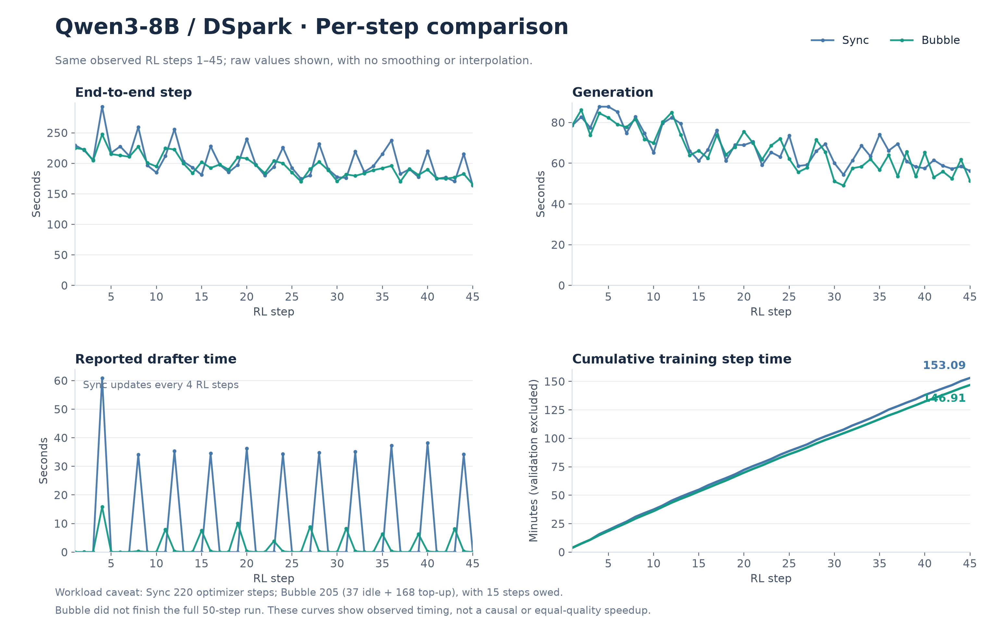

# Bubble Time Drafter Training

Last updated: 10/21/2026

### Compatibility limits

Bubble Time currently requires the legacy trainer. V1 rejects
`scheduler.execution.strategy=rollout_idle_worker` before worker setup because
its rollout idle event bus lifecycle is not integrated.

Bubble Time also rejects an enabled convergence-freeze policy with
`drafter_convergence_freeze.economics.enabled=true`, including when
`publish_async=false`. Bubble publication is asynchronous and does not yet
provide the paired probes and complete per-quota costs required by the ROI gate.
Use `economics.enabled=false` for Bubble, or synchronous drafter execution for
ROI-based freezing.

### Periodic checkpoint safety

Bubble defers a periodic checkpoint while a collected quota is unfinished or
awaiting publication acknowledgement. The save request is retried at the existing
post-actor-update, pre-weight-sync safe point, without forcing extra
training or changing collection, loss, or publication policy. The checkpoint uses
the actual later RL step for both actor and drafter; it never labels later weights
with the originally requested step. Repeated save requests coalesce.

This adds no per-step model copies or additional checkpoint payload. It can delay
the latest recovery point if a quota takes a long time to finish; look for
`[BubbleTime] checkpoint_deferred`. Final/freeze saves fail explicitly if their
quota is unfinished, instead of silently producing an incomplete recovery point.
Older checkpoints containing pinned/reserved replay samples are rejected on
restore because their quota/session owners were not persisted. Resume from a
checkpoint taken after quota publication; removing ownership flags would lose
unfinished training.

## Acceptance sidecar file I/O

For a paired Bubble/Sync performance run, disable the file-based acceptance
fallback explicitly on both runs:

```bash
actor_rollout_ref.rollout.drafter.vllm.acceptance_sidecar_enabled=False
```

Restart the driver and rollout workers after changing this option. The default
is `true` for compatibility. With `false`, SPECO does not auto-create a sidecar
directory and skips sidecar reads/writes even if a stale path is present. The
worker logs `disabled by config; no file IO` once. Checkpoints, model execution,
in-memory acceptance counters, request/engine metrics, and Bubble event-bus and
resource-lease selection remain unchanged. If request/engine metrics are absent,
the file fallback also remains unavailable; do not interpret missing acceptance
metrics as zero acceptance. This option controls acceptance statistics only, not
checkpoint files or other sidecars. Re-enable it with `True` if the file fallback
is required. Do not clear `trainer.default_local_dir` to disable statistics.

Bubble Time is the rollout-idle execution path for online drafter co-training.
Its goal is to keep the same drafter-training quality target as synchronous
training, while moving as much drafter optimizer work as possible into rollout
idle windows.

The intended behavior is:

1. Collect training features using the same data policy as the synchronous path.
2. Register a drafter-training quota for the collected data.
3. Train the drafter on an idle rollout worker group when a safe idle window is
   available.
4. Accumulate partial progress across idle windows instead of requiring every
   idle launch to finish the full quota.
5. Publish the completed drafter snapshot to all rollout workers.
6. Retain the same optimizer owner across quotas; inference-weight
   acknowledgements alone do not transfer optimizer or scheduler state.

This keeps Bubble Time from producing an artificial speedup by simply doing
less drafter training. In quality-alignment runs, use the same optimizer-step
quota, batch size, effective global batch, learning rate, and sampling order as
the synchronous configuration.

## Paired GPU Example

The [4-GPU DSpark/vLLM example](../examples/bubble_time/run_qwen3-8b_drafter_dspark_vllm.sh)
reuses the regular DSpark launch and switches only the execution/quota policy
between Bubble and Sync. Set compatible local checkpoints and dataset paths:

```bash
export MODEL_PATH=/path/to/Qwen3-8B
export DRAFTER_PATH=/path/to/vllm-compatible-dspark-drafter
export TRAIN_FILE=/path/to/train.parquet
export TEST_FILE=/path/to/validation.parquet

SPECO_TRAINING_MODE=sync CKPTS_DIR=./checkpoints/dspark_sync \
  bash examples/bubble_time/run_qwen3-8b_drafter_dspark_vllm.sh

SPECO_TRAINING_MODE=bubble CKPTS_DIR=./checkpoints/dspark_bubble \
  bash examples/bubble_time/run_qwen3-8b_drafter_dspark_vllm.sh
```

Run both modes from the same initial target/drafter checkpoints, on the same
hardware and software stack, without another workload sharing the devices.
The recipe uses 4 GPUs, TP=2, SP=2, 32 rollout prompts, 20 drafter optimizer
steps per cycle and collection/training intervals of 4. Both modes use the
same sample caps, per-GPU drafter batch size and learning rate. Bubble retains
the scheduler's automatic gradient accumulation compensation for its smaller
writer group; verify the reported effective batch and completed optimizer
steps instead of comparing only the per-GPU batch setting. These settings
align the training workload, not bitwise parameters or identical sampled
generation trajectories.

The default run lasts 40 PPO steps with periodic validation/checkpoint saves
disabled to simplify timing comparison. The final-quota drain is still required;
include shutdown/drain time when comparing complete jobs. Caller Hydra overrides
are forwarded last, for example `trainer.total_training_steps=100`.

This is an interval/quality-alignment recipe, not the adaptive production policy:
critical-path fallback is enabled to complete overdue 20-step quotas. It does
not promise that all training is hidden. Writer migration and early publish
staging remain disabled for attribution. Keep-hot defaults to false to reduce
memory pressure. With measured memory headroom, set `SPECO_KEEP_HOT=true` on the
Bubble command to avoid repeated activation; compare throughput, memory and
reclaim waits before retaining it. No GPU capacity or speedup is guaranteed.

In this example's Bubble mode, `VERL_DRAFTER_KEEP_HOT_TRIM_CACHE` defaults to
`true` and is exported to workers. It only trims unused allocator cache when
keep-hot is active; live training tensors remain resident. Override it with
`VERL_DRAFTER_KEEP_HOT_TRIM_CACHE=false` to compare cache reuse costs. The Sync
example and the library-wide default remain unchanged. Trimming can incur
cleanup/reallocation overhead and does not guarantee OOM safety.

For profiling, enable `VERL_SPECO_PHASE_TIMING=true` on a diagnostic run. For a
performance comparison, keep detailed phase/memory diagnostics disabled in both
modes. Check `bubble/idle_optimizer_steps_total`,
`bubble/critical_path_topup_optimizer_steps_total`, quota debt, publish ACKs,
`drafter/spec_decode/mean_acceptance_length`, output token counts and per-token
Generation/actor timing. Do not sum per-step counters that can be overwritten
when several plans finish in one PPO step; use cumulative counters and quota
repayment records.

The example is also listed in the manually triggered E2E workflow. That workflow
applies its own short smoke-test overrides; a smoke pass does not validate this
recipe's 20-step quotas, idle utilization or speedup. Use the commands above
for paired performance runs.

## Execution Flow

```text
rollout / old_log_prob feature collection
        |
        v
training quota registered for one data snapshot
        |
        v
idle rollout worker group selected
        |
        v
partial drafter training during rollout idle windows
        |
        v
quota fully repaid
        |
        v
publish staged drafter snapshot to rollout workers
        |
        v
record per-worker publish acknowledgement and local drafter version
```

Only one writer group owns a quota at a time. Other rollout workers receive the
published drafter weights; optimizer state stays with the writer by default.
After a quota is finished and published, the writer remains authoritative even
when its tensors are parked on CPU. Writer migration is experimental and defaults
to disabled (`idle_worker.writer_migration_enable=false`). Keep this default until
real subgroup handoff, checkpoint save/resume and next-update consistency have
been validated on the target GPU/NPU stack. To opt in after validation:

```bash
actor_rollout_ref.rollout.drafter.training.scheduler.idle_worker.writer_migration_enable=true
```

When enabled, at the start of a new quota another eligible
idle group can receive the complete CPU training state: corresponding parameter
shards, Adam state, learning-rate scheduler, optimizer counters, replay data,
target-head snapshots and training RNG. All destination shard layouts and
optimizer parameter ordering are validated before applying the transfer.
Only equal-size, parked CPU shard layouts are supported; DTensor migration and
keep-hot handoffs retain the existing writer. No mid-quota transfer is allowed.

The remaining idle window must cover transfer, restore, a complete optimizer
step and parking. The initial transfer estimate uses 2 GiB/s and is subsequently
bounded by measured migration time. Short windows retain the owner rather than
paying an unproductive transfer. This cost model needs device-host validation;
more idle utilization is not guaranteed when transfer itself is too expensive.

Replica-local trainers also use that writer for blocking top-ups, with gradient
accumulation adjusted to preserve the Sync effective global batch. Dispatching a
Sync plan to every rank does not turn independent replica-local FSDP groups into
one shared optimizer. The full-collective fallback is only valid for an actual
full-collective topology with no private writer history.

## Recommended Configuration

`idle_worker.keep_hot_between_plans=false` is the default. Drafter tensors can
stay on the device between idle leases within a rollout, but are parked on CPU
before PPO computation and before rollout weight updates/wake-up. Parking also
applies to a writer whose training task has already completed. It preserves the
optimizer state, optimizer-step count, replay snapshot, and remaining quota.

Set the following only when memory is sufficient for the main workload and the
resident drafter trainer together:

```bash
actor_rollout_ref.rollout.drafter.training.scheduler.idle_worker.keep_hot_between_plans=true
```

This opts out of boundary offload; it does not permit training during PPO.
The trainer builds and parks its models before timed rollouts, and measures a
second restore/park and a discarded CPU weight snapshot without optimizer
updates to calibrate group admission and final staging cost.
Subsequent activation restores CPU tensors rather than rereading the checkpoint. First
backward/optimizer initialization can still be more expensive than steady-state
steps. Confirmed runtime idle events and training resource leases remain required
for safe overlap; historical windows bound the number of planned steps after
bootstrap. Generation completion does not launch another Bubble task using an
artificial post-rollout window.

When a plan carries a deadline and keep-hot is disabled,
the worker parks its training state as part of the plan's reserved tail, before
returning the idle lease. Historical windows use estimated execution deadlines,
not authoritative runtime promises; post-generation reclaim remains necessary.
If a final snapshot cannot fit and keep-hot is disabled, quota plans stay partial and leave at least one
optimizer step pending; the completed snapshot waits for a larger window or
configured blocking completion. No quota steps are discarded.

Measure activation, training, and boundary parking costs separately. In particular,
`timing_s/drafter_memory_park_before_post_rollout` and
`timing_s/drafter_memory_park_before_update_weights` expose residual main-path
offload overhead. Short windows may be skipped when restoration and a complete
optimizer step cannot fit. Use quota completion fallback when bounded training
freshness is required; neither overlap nor a speedup is guaranteed for every workload.

Each data version can register only one quota. Discovering a retained buffer at
a later step does not create another quota for already-trained data. Restore
costs are learned per writer group; measured device parking is charged to the
tail reserve. Publication and in-flight-step waiting are not charged again as
the deadline guard. Bubble FSDP2 full-head export materializes only the actor
projection, avoiding full actor parameter enumeration while preserving all rows.
Unsupported actor layouts and Sync retain their existing export path.

Workers report individual optimizer-step durations. Only participating ranks
with successful optimizer steps contribute; empty results from other rollout
groups cannot suppress timing updates. The first cold optimizer
update is excluded from steady-state estimates, and writer-local synchronous
top-ups also refresh the estimate. FSDP1 optimizer checkpoint export/load use
the writer's explicit process group during optimizer state-dict conversion as
well as during the outer DCP operation. This explicit subgroup conversion is
limited to replica-local Bubble trainers; Sync retains its original DCP
optimizer conversion and checkpoint process-group behavior.

The main switches live under
`actor_rollout_ref.rollout.drafter.training.scheduler`.

```bash
actor_rollout_ref.rollout.drafter.training.scheduler.execution.strategy=rollout_idle_worker \
actor_rollout_ref.rollout.drafter.training.scheduler.training_quota.enable=true \
actor_rollout_ref.rollout.drafter.training.scheduler.training_quota.target_steps=20 \
actor_rollout_ref.rollout.drafter.training.scheduler.training_quota.trigger_mode=interval \
actor_rollout_ref.rollout.drafter.training.scheduler.training_quota.allow_critical_path_fallback=true \
actor_rollout_ref.rollout.drafter.training.scheduler.idle_worker.group_mode=auto \
actor_rollout_ref.rollout.drafter.training.scheduler.idle_worker.group_size=null \
actor_rollout_ref.rollout.drafter.training.scheduler.idle_worker.training_groups=[] \
actor_rollout_ref.rollout.drafter.training.scheduler.idle_worker.full_collective_fallback=false
```

For strict Sync/Bubble quality comparison, keep `target_steps` equal to the
synchronous drafter `step` setting and keep the same collection interval,
batching, and data sampling settings. For production runs, Bubble Time can still
use interval triggering, or it can refresh based on acceptance-length and loss
signals through `trigger_mode`; the scheduler should continue an unfinished
quota on the same data snapshot rather than repeatedly collecting new data that
will not be trained.

With quota enabled and `trigger_mode=interval`, old-logprob collection first
selects samples using Sync's logical-owner sample/token budgets, hard-sample
policy, and hidden-state windows. It then routes the selected set to the current
writer without selecting again. Thus a two-owner `16 + 16` budget stays at 32
samples both before and after writer election, subject to the same candidate
and token limits as Sync. `drafter/selection/sync_aligned_collection=1` identifies
this path. Adaptive collection retains its existing writer-local
minimum and budget policy. This aligns collection, not bitwise optimizer updates
or end-to-end quality; those still need device validation.

For the first nonempty interval-mode old-logprob collection, the scheduler
selects the bootstrap writer before dispatch and sends the complete selected
pool directly to that group. It does not first distribute the pool and then
gather it again. Empty or skipped collection does not elect a writer. Selecting
this data destination does not mark the optimizer initialized or the writer hot;
the existing first-quota bootstrap and real-idle admission checks still apply.
Until that bootstrap finishes, another group cannot take over its data snapshot.

Initial writer election uses recent, recency-weighted observations with a
confidence discount for sparse history instead of selecting an old p75 spike.
This changes only the initial election score, not training admission deadlines
or the ownership of an already-trained writer. Completed training reports
`bubble/training_quota_debt_before` and `bubble/training_quota_debt_after`;
`bubble/training_quota_debt_steps` in its result is the post-training value.

After a registered quota completes and publishes, scheduling reports
`reason=training_quota_complete` while there is no new collection. It skips idle
window probing and worker data-inspection RPCs rather than rediscovering the
consumed snapshot on every idle event. A new durable collection immediately
registers fresh debt and re-enables training; unfinished quotas and initial
data discovery retain their existing paths. Collection counts in Bubble's
scheduling context refer only to the current PPO step, not the preceding step.
Delayed target-head dispatch keeps the version captured when export started,
even if the driver's global step has advanced before dispatch completes.

`allow_critical_path_fallback=true` lets the scheduler top up unfinished quota
on the critical path when idle windows are not enough. This is useful for
quality-alignment and stability testing. For pure production throughput tests,
turning it off makes the resource-isolation contract stricter, but stale or
insufficiently trained drafters may take longer to refresh.

## Key Logs and Metrics

Use these logs to confirm that Bubble Time is actually using rollout idle time:

- `training_quota_registered`: a new quota was created for a data snapshot.
- `idle_writer_elected`: an idle worker group was selected for drafter training.
- `training_quota_repaid`: idle or top-up training reduced the quota debt.
- `rollout_drafter_versions_updated`: publish completed and rollout-worker
  drafter versions were recorded.
- `idle_group_stale_drafter_version`: a candidate writer group was rejected
  because it had not acknowledged the latest published drafter version.

Useful metrics:

- `timing_s/step`: end-to-end step time.
- `timing_s/drafter`: drafter training time left on the critical path.
- `timing_s/gen`: rollout generation time.
- `drafter/spec_decode/mean_acceptance_length`: speculative-decoding quality.
- `bubble/training_quota_debt_steps`: unfinished drafter-training quota.
- `drafter/train_successful_steps_max`: successful drafter optimizer steps.

Acceptance observability uses the same path for Sync and Bubble. Each generated
output drains vLLM aggregate counters exactly once; nested idle-lease wrappers
must not replace those counters with an empty second snapshot. The callback
accepts speculative stats on either scheduler or iteration records, choosing
one source instead of double-counting mirrored fields. When aggregate stats are
missing, complete, valid, uniquely identified request rows can supply the
fallback: `1 + sum(accepted_tokens) / sum(verify_rounds)`, not an unweighted
average of request means. Missing or incomplete statistics omit the metric;
they do not produce a synthetic acceptance length of zero or one.

No additional flag is needed for the low-frequency `[SpeCoAcceptance]` messages:
startup `hooks` and `stat_logger_registered` report runtime compatibility;
`stats_source_ready` reports the first usable callback source; one
`rollout_stats` line per generation return reports the PPO step, source,
availability, verify rounds and accepted-token count. If `available=False`,
check the reported reason and startup messages before comparing quality.
These diagnostics do not add per-token logs, device synchronization or RPCs.

When comparing with synchronous drafter training, exclude checkpoint-save steps
from the speed calculation because checkpoint I/O is orthogonal to Bubble Time.

## Diagnosing keep-hot device memory

### Window and training-budget timelines

`idle_event_timeline` reports request completion callback, event emission, resource
lease release, bus receipt and driver receipt timestamps when supplied by the
runtime. `idle_window_timeline` adds the usable idle start and window closure.
Request completion callbacks are not device kernel completion timestamps; no
extra device synchronization is introduced to measure them. Lease release only
proves the existing runtime resource-ownership contract, not that all accelerator
allocations have been freed. Missing timestamps remain absent, rather than being
invented. Cross-node delivery lag measurements require synchronized host clocks.

Per-replica histories now separately report `generation_start_closed_p75_s` and
`generation_end_closed_p75_s` with sample counts. These are close-event cohorts:
they help distinguish request gaps and rollout tails but do not predict which
cohort a currently open window will belong to. Admission therefore retains the
existing mixed-history safety bound until a runtime supplies that classification.

`optimizer_plan_timing` splits the first optimizer step from subsequent steps.
Only subsequent non-warmup steps calibrate steady throughput; a one-step plan does
not overwrite steady throughput with its first-step allocation cost. Measured
first-step excess is reserved once per plan as `first_step_extra_s` within the
startup budget. A hot writer entering a new target-head version also reserves its
measured head preparation; repeated plans for the same version do not pay that
reserve again. `training_activation_breakdown` reports host head apply, model and
optimizer restore, head movement and device head apply separately. These are wall
times without added device barriers; asynchronous device waits may appear in the
first optimizer step instead. GPU/NPU testing must validate the resulting budget.

`weight_update_breakdown` and `timing_s/upstream_weight_update_only` separate the
original checkpoint-manager weight-update call from the external drafter hook.
The upstream call can still include runtime sleep/wake and other built-in work;
it is not a pure actor tensor-copy measurement. These new fields overlap existing
`timing_s/update_weights` and publish metrics and must not be added to them again.

### Validation isolation

Validation does not start the idle event thread, launch drafter training or
collect drafter samples. Bubble drains outstanding training/head export and
publication before validation; any locally deferred publish is completed before
validation generation admits requests. The validation guard survives mutation of
batch metadata and is restored even on exceptions. Validation runtime events are
discarded rather than entering training buffers/window history; late events with
timestamps through the validation exit boundary are also ignored. Look for
`validation_isolated` and `bubble/training_blocked_by_validation`. A quota collected
at step 10 therefore resumes during training rollout 11, not validation at step
10. Validation idle capacity is intentionally excluded from performance accounting.
Sync retains its original wait-before-validation path.

### Completing a hot-writer quota

For replica-local DSPARK/FSDP1 hot publication, the exporter now exposes full
parameters with `writeback=False` and copies only publishable parameters and
persistent floating buffers on the writer leader. Frozen target-shared weights,
nonpersistent buffers and entries excluded by publish-name patterns are not copied
to CPU. Publish precision is applied before host transfer. This still requires
FSDP1 parameter gathering; it does not avoid frozen weights in the same flat
buffer, and GPU full-parameter materialization can change temporary memory peaks.
Sync, checkpoint export and other drafter backends retain the original path.
Measure `publish_trainable_only_export` bytes/time and device headroom before long
runs; subgroup gathering and publish payload equivalence need GPU validation.

When a keep-hot writer has a measured historical window large enough for another
optimizer step, soft critical-path topups are postponed until further idle leases
or the existing hard completion deadline. `quota_soft_topup_deferred` explains the
decision. The exact quota, data snapshot, hard freshness deadline and blocking
completion at that deadline are preserved. This prediction does not guarantee a
future window; if it fails, remaining work is still completed synchronously at the
configured hard boundary. Acceptance length must be evaluated with the changed
within-deadline update timing.

If optimizer work fits an idle window but final snapshot export does not, a
keep-hot writer can now finish the full quota with `publish_snapshot_deferred`.
It normally exports the snapshot at the existing safe publish point; if training
finishes early enough, all writer ranks may agree to prepare it in the remaining
idle budget instead. The writer rejects new training until staging finishes and verifies its
optimizer step is unchanged. Collection remains blocked until publish completion.
Cold/offloaded writers retain the original final-tail admission rule. This avoids
leaving one optimizer step solely to pay the export cost; it does not make snapshot
export free or guarantee its cost is hidden. Watch `deferred_snapshot_staged` and
publish success before treating the cycle as complete.

### Version-safe target-head prefetch

Bubble submits its head export after old-logprob collection, allowing eligible
FSDP2 head-only export to overlap the following reference stage. Before actor
update, an explicit export fence waits for any unfinished export; only subsequent
host dispatch may overlap the actor update. `timing_s/drafter_target_lm_head_export_fence`
reports the remaining critical-path wait. Unsupported layouts keep synchronous
export, and the async path refuses fallback to a full-actor reload. Sync uses the
unchanged synchronous getter. Measure reference-stage time and memory as well as
submit/fence time: overlapping an export can still cause resource contention.
Async selection first probes every participating actor rank without gathering
weights, and caches the capability result. The worker probe and exporter share
the same candidate selection, including the wrapped-class drafter overlay used
by verl 0.8 when rollout config fields are stripped. If any rank cannot export
head-only (or probing is unavailable), the driver chooses the original synchronous
getter before submitting export. Check `target_head_export_capability` for each
rank's reason; the async full-actor-reload guard remains enabled.

For first-stage scheduling diagnosis, distinguish `bubble/idle_optimizer_steps_total`
from `bubble/critical_path_topup_optimizer_steps_total`. These are cumulative
counters since process startup (not checkpoint-restored training counters); take
their differences over the comparison interval. Writer-local synchronous topups
are not counted as `drafter/idle_trained`, even though they share the Bubble
execution strategy. An idle-path launch alone does not prove all its work was
hidden from the main critical path.

Window rejection logs include `min_required_s`, `budget_deficit_s`, startup/tail
reserves and the selected writer. A writer with a short window is reported as
`window_too_small`, rather than being masked by another group's migration
requirement. `idle_overhead_updated` logs separate activation, park and snapshot
costs; successful writer-local topups also calibrate their shared overhead, while
full-collective Sync plans do not change replica-local estimates.
Worker results measure non-park cleanup separately before per-rank aggregation,
so subtracting maxima from different ranks cannot distort the budget. Snapshot
cost contributes only to the final tail, not partial training admission. Inspect
`memory_park_breakdown` and `training_memory_parked` for model, optimizer, target
head, synchronization and cache-release costs; the required measured park reserve
is not removed merely to admit more work.

Set `VERL_DRAFTER_MEMORY_DIAGNOSTICS=true` on training workers to emit
`[DrafterMemory]` logs at activation, keep-hot cleanup and parking. Values are
bytes: local target-head, model, buffers, gradients, optimizer, replay and publish
storage, plus allocator allocated/reserved/cache totals. Shared storage is counted
once; no FSDP all-gather or device-to-host copy is performed. Unattributed allocated
memory includes tensors outside these categories. Peak allocation is the allocator
peak since its last reset, not necessarily this training window. Process memory
reported by an OOM also includes non-PyTorch allocations, so these numbers need not
sum to the process total. Diagnostics are best-effort and disabled by default.
The SPECO entrypoint explicitly forwards the two diagnostic switches to its Ray
TaskRunner. Check each training worker's `worker_environment` log to confirm the
effective values before trusting missing diagnostics. Existing actors must be
restarted when changing environment variables.
Opt-in memory reports use WARNING level so default worker log filtering does not
hide them. Reports include `revision=3` and the trainer's loaded source path; an
initial `replica_local_initialized` report confirms the implementation was loaded
before any training starts. This initial report is not the peak training footprint.
Revision 3 additionally counts retained replay sessions and local model/handle/
flat-parameter attributes, plus direct trainer/backend tensor containers. Shared
storage is still counted only once. `extra_storage` lists the largest additional
storage holders to help identify live memory left after parking. Inspection is
bounded and read-only; it does not traverse autograd graphs, run full-parameter
collectives or free private FSDP buffers. Unknown allocations can still remain.
On CUDA, large unidentified memory after parking/cache trimming additionally logs
`unattributed_allocator_blocks`, showing active block addresses/sizes and pending
free states from allocator metadata. This does not resolve Python ownership or
automatically free any blocks, and is disabled with memory diagnostics.

With keep-hot enabled, optionally set `VERL_DRAFTER_KEEP_HOT_TRIM_CACHE=true` to
return unused allocator blocks after a training lease. Live model, optimizer and
target-head tensors remain resident, and training progress is preserved. This
does not solve OOM caused by live tensors; cache reuse can be faster, so the option
is disabled by default. Compare before/after cache-trim logs and end-to-end time
before enabling it in production. For insufficient live-memory headroom, use
`idle_worker.keep_hot_between_plans=false` instead. Sync cleanup is unchanged.
`keep_hot_cache_trim` reports elapsed time, released reserved bytes and allocated
bytes before/after. Use this to verify that cache was actually released without
offloading live tensors. Run an initial diagnostic short test across two quota
cycles and actor updates; do not assume a successful trim guarantees OOM safety.
When keep-hot is enabled, idle tail admission excludes historical offload cost
because main-workload parking is disabled in that mode. Non-park cleanup (including
optional cache trimming) and final snapshot costs remain in their respective
budgets. Disabling keep-hot retains the measured park reserve for OOM safety.

## Boundary and budget verification

The rollout-return timestamp is captured before event-thread shutdown and
training reclaim. Historical idle windows end at that timestamp; reclaim wait
must not become a larger future idle budget. Historical windows also carry an
execution deadline, not just a maximum batch count. A deadline is a conservative
estimate, not a guarantee: an in-flight optimizer step cannot be preempted.

Model prewarming does not prove optimizer initialization. With quota fallback
enabled, the first quota bootstraps real optimizer state at the first safe point
where collected data and its immutable target head are ready, rather than waiting
for the hard freshness deadline. Before any state is trained, the bootstrap
prefers measured idle capacity instead of metadata order. These are real quota
optimizer steps, not extra dummy updates. This adds a one-time critical-path
cost and must not be counted as hidden Bubble training.
Successful writer-local training then enables ordinary idle admission, even if
keep-hot is disabled. Disabling critical-path fallback cannot guarantee progress
when no sufficiently long authoritative window exists.

With keep-hot enabled, a new target-head version is applied to the resident writer
after PPO finishes, before subsequent idle admission. This only applies the
cached frozen head: it does not restore model/optimizer, train extra steps, change
the replay snapshot or activate other replicas. Every writer rank must acknowledge
the exact version after its device copy completes. The elapsed time is reported
as `timing_s/drafter_target_head_prepare_safe_point`; `hot_writer_head_safe_point`
and `hot_target_head_prepared` report completion. Once prepared, its cost is not
reserved again in the following idle window. Cold activation observations are
not relabelled as measured hot-head preparation. This preparation is not free;
compare its one-time-per-version cost against the recovered idle work.

Only genuine idle plans yield between complete optimizer steps and agree on stop
requests through the trainer's explicit writer SP/DP groups. An accumulation is
atomic; stopping does not consume a partial accumulation or repay quota debt.
Sync and synchronous quota top-ups retain their previous accumulation path.
`timing_s/drafter_idle_control` measures this small-message control overhead;
it is not a zero-cost operation and does not involve other rollout replicas.

A completed deferred-snapshot plan may prepare its immutable CPU snapshot before
cleanup if every writer rank has enough remaining time for the measured final
tail. Otherwise it retains the existing safe-point export. This optimization
does not publish an incomplete quota and does not move device export into PPO.
It advances snapshot preparation only; engine staging/commit and ACK still have
cost and remain protected by the publish safe point.

For the first device test, keep the existing topology/configuration and run at
least three complete quota cycles. Check `rollout_boundary_timing`,
`quota_optimizer_bootstrap_planned`, `hot_writer_head_safe_point`, `optimizer_plan_timing`,
`training_quota_repaid`, and `publish_succeeded`. The optional
`publish_snapshot_staged_in_idle` log appears only when enough budget remains.
Compare `timing_s/bubble_rollout_rpc`,
`timing_s/bubble_rollout_return_to_ready`, and
`timing_s/drafter_reclaim_wait`; all are wall-time measurements, not sums of GPU
kernel durations. `bubble/weight_update_source_step` identifies the source step
of weight-update metrics, which may be flushed in the following step's row.

After functional verification, run fresh Sync and Bubble baselines on identical
devices, model/data seeds, collection interval, actual sample policy, effective
global batch, optimizer quota and learning rate. Configuration similarity alone
does not prove identical training snapshots. Disable periodic validation and
checkpointing for the performance run (then test both separately). Report both
whole-run wall time including bootstrap/final drain and steady-state step time,
plus accepted length and response length. Compare several runs; do not infer a
10–15% speedup or guaranteed quality equivalence from successful idle launches.

### Diagnosing exposed training costs

Keep topology and writer ownership unchanged when measuring reclaim overhead.
`reclaim_sent`, `reclaim_requested`, `training_stop_boundary`, and
`training_cleanup_boundary` report driver send, worker receive, stop, and cleanup
completion timestamps. Cross-host wall clocks must be synchronized before using
send-to-receive differences to estimate RPC queue delay. Worker-local durations
`timing_s/drafter_reclaim_receive_to_stop` and
`timing_s/drafter_reclaim_receive_to_cleanup` use a monotonic clock and report the
maximum across participating ranks; they are overlapping intervals, not additive
costs. They exclude waiting before the reclaim RPC reaches a worker. A peer may
stop the group before its own local reclaim RPC arrives, so a zero local interval
does not prove zero driver wait.

Completed idle-control timers are carried into the step metrics and are no longer
overwritten by a subsequent no-launch/top-up outcome. Use
`timing_s/bubble_event_thread_stop` and `timing_s/bubble_event_drain` to identify
delay before reclaim dispatch. `training_data_probe` measures the existing data
inspection RPC plus aggregation without adding a probe RPC.
`timing_s/drafter_schedule_probe` covers the last scheduling/preflight call and
`timing_s/drafter_target_head_poll_last` covers the last prefetch poll, including
dispatch if that poll advances the state machine. These can overlap other named
timers and must not be summed blindly or subtracted again from step time.

Genuine idle training uses a short timer yield (requested 1 ms) before each
optimizer-step control agreement, so queued event-loop I/O has a chance to run.
Unlike `sleep(0)`, this is not just another immediately-ready continuation.
It does not preempt an accumulation or guarantee that Ray's RPC dispatcher has
delivered a stop request. Actual timer scheduling may take longer than 1 ms;
`timing_s/drafter_idle_control_yield_elapsed` reports the maximum accumulated
yield time across participating ranks. Sync and blocking top-ups do not use
this yield. Verify driver-send to worker-receive latency on the real Ray setup;
if requests still arrive only after training ends, a separate control-delivery
path is needed rather than increasing the idle deadline.

Only genuine idle plans calibrate hot idle first-step overhead. Blocking top-ups
can still calibrate steady optimizer throughput and their cleanup/export costs,
but their first step no longer inflates idle restart reserve. Real measured idle
first-step and cleanup costs remain budgeted; keep-hot does not make them free.
Step-level `drafter/trained` and `drafter/idle_trained` preserve completed idle
outcomes when the actor hook launches nothing. `train_successful_steps_max` is
the maximum per-plan count across completed outcomes in the step, not the sum of
idle and top-up updates; use quota repayment and cumulative optimizer counters
to verify the complete training amount.

The rollout event loop consumes proven-ready training outcomes instead of only
releasing their resource lease. This repays quota once, retires `RUNNING`, and
allows a completed small plan to be followed by another plan without requiring a
new idle event. `idle_training_completion_consumed` identifies this transition;
`bubble/idle_optimizer_steps` and training timers accumulate across those plans.
The continuation keeps the writer and quota snapshot, and caps admission by the
previous absolute deadline. It does not renew a historical prediction or bypass
first-step/cleanup reserves. Reclaim, deadline stops, and unsuccessful outcomes
close continuation for that rollout; subsequent rollouts start fresh admission.

A completed final quota queues its publication until the existing safe point;
the event loop cannot start a new quota over that frozen snapshot. Publication
callback failures retain the queue, and failed training futures are surfaced at
the PPO boundary. Generation return closes admission before joining the event
thread, including a check after a potentially slow preflight. Sync remains on
its original execution/publication path. Continuations can incur another
preflight, first-step warmup, and cleanup; verify net end-to-end savings, not just
increased optimizer counts. A long idle duration observed after the fact is not
permission to extend an estimated deadline.

First verify at least three complete quotas and matching publish ACKs on the
existing device configuration. Then compare an aligned Sync/Bubble run, including
bootstrap and final drain, excluding checkpoint/validation steps consistently.
Do not switch FSDP implementations or migrate writers in the same experiment:
those require separate subgroup state/optimizer/checkpoint consistency tests.

## Independent reclaim control and experimental writer migration

Bubble writers receive the lease-bus name in their plan. A CPU-only watcher polls
the independent actor every 20 ms; it never runs model, optimizer or collective
operations. Driver reclaim writes a plan-scoped flag there instead of queuing
behind training. Waiting rollout requests set the flag directly, without waiting
for the driver's lifecycle-event poll. Writers still stop group-wide between
complete optimizer steps. Late flags cannot stop a new plan; pending generation
requests take priority over continuation. Watcher failure requests a safe stop;
unavailable control submission falls back to the worker RPC. Restart all actors
when deploying. Check `reclaim_received` with `source=lease_bus` and compare
delivery timestamps and reclaim wait. There is small CPU/control RPC overhead;
this cannot preempt the in-flight optimizer step or cleanup.

Migration is off by default. Under
`actor_rollout_ref.rollout.drafter.training.scheduler.idle_worker`:

```yaml
writer_migration_enable: false
writer_migration_history_steps: 4
writer_migration_min_idle_gain_sec: 1.0
writer_migration_cost_margin: 2.0
```

Completed rollout windows are paired by group. Candidates need the exact latest
published-version ACK, equal shard topology, and at least a 1-second idle advantage
in 75% of the last four rollouts. Decisions are recorded after publication ACK,
even with migration disabled: `writer_switch_decision` and metrics
`bubble/writer_switch_current_idle_mean_s`,
`bubble/writer_switch_candidate_idle_mean_s`,
`bubble/writer_switch_missed_idle_s`, and
`bubble/writer_switch_estimated_gain_s`. Missed idle is the positive observed
window difference, not a measured speedup or proof that all of it was trainable.
Prospective gain over a bounded history-sized horizon must exceed estimated
transfer, activation and cleanup cost times the margin. Actual window admission
and resource leases must also succeed. Cost estimates require device measurement.
Only the boundary after publication ACK and before the next quota's first update
allows migration; no mid-quota switching is allowed.

The handoff copies CPU parameter/buffer shards, optimizer/LR-scheduler states,
training/optimizer/checkpoint counters, replay and target-head snapshots, and
each rank's canonical post-training RNG. Validate layouts before applying shards;
change ownership only after all destination ACKs. A hot source must have enough
confirmed idle for parking and transfer, never offload it during its rollout.
The transfer also requires another active serving group to hide its cost. With
only two groups, a resident source and an idle destination leave no serving
overlap, so that handoff is skipped; a parked source does not need a device lease.
Enabling migration with keep-hot therefore does not guarantee a switch. Partial
apply/ACK failure is fatal. FSDP2/DTensor and unequal-topology handoffs are not
enabled by this CPU-shard protocol.

A prewarmed destination is parked under its idle resource lease before import;
the switch budget includes parking and a cold destination restart, even with
keep-hot enabled. Unsupported/uninitialized state or a layout-validation failure
is retried only after the quota/version or candidate changes, not on every event
poll. Pre-apply rejection keeps the source as owner; partial apply or missing
destination ACKs remain fatal. Logits-based training does not require a target-head
prefetch ACK to migrate.

First test reclaim with migration disabled. On the Linux training host:

```bash
python -m pytest tests/integration/test_rollout_idle_events.py tests/unit/test_training_worker_preflight.py tests/unit/test_bubble_training_boundaries.py
```

Coverage includes real Ray delivery to a busy async actor, CPU model/Adam/LR
handoff, RNG-dependent next-loss/update equality and checkpoint serialization
roundtrip. Skips do not count as validation. Before real migration, separately
validate actual writer subgroups, GPU/NPU restoration and distributed checkpoint
save/resume. Then compare migration off/on with aligned data and full optimizer
quota, including handoff cost in whole-run timing. CPU tests alone do not justify
enabling migration by default.

### Window capacity and first-step calibration

Idle batch caps are tracked per writer group. Early rollout reclaim ends the
current plan but does not collapse the next window's capacity to the number of
steps completed in that short opportunity. Deadline exhaustion still reduces
the cap, and the existing generation-slowdown guard remains active. Successful
window-limited plans progressively recover the cap. Historical windows still
bound planned work; continuation never renews the original absolute deadline.

First-step calibration uses the last four observations for each group and
restart mode: cold, hot, or hot continuation in the same rollout window.
Cold optimizer initialization and synchronous top-ups do not contaminate hot
restart estimates. A parked writer still pays cold restore costs, even for a
continuation. No quota, data snapshot, effective batch, or Sync training behavior
is changed by these admission-budget adjustments.

Independent reclaim delivery uses the CPU lease-bus watcher described above.
The control acknowledgement has a bounded timeout and falls back to the worker
RPC when unavailable; neither path interrupts a partially executed optimizer
step. Validate notify-to-receive delay, cleanup wait, idle optimizer steps, and
whole-run timing on GPU/NPU before claiming a performance improvement.

### Collection failure and configuration defaults

A collection is successful only after every owner acknowledges finalize with
the same transaction ID, worker incarnation, and source step. A finalize RPC or
ACK failure raises `CollectionFinalizeError` with reason
`collection_finalize_failed`, `collected=false`, and
`committed_unfinalized=true`. Background idle collection retains this error and
stops admission; the PPO boundary raises it instead of silently training on an
ambiguous dataset. Recovery requires restarting from a consistent checkpoint.

Do not blindly roll back after partial finalize: an owner may have already
discarded its rollback journal while another still retains one. Rolling back
only the latter creates divergent datasets. Failures before finalize retain
their existing abort/rollback behavior.

Python constructors, mapping-based configuration, and YAML now share production
defaults: `training_quota.trigger_mode=adaptive` and
`training_quota.allow_critical_path_fallback=false`. Strict Sync-equivalence runs
must explicitly select `interval` and, when blocking completion is required,
`allow_critical_path_fallback=true`.

Validation isolation is enforced by the trainer's validation guard and event
cutoff, not an unused sampling-parameter flag. The obsolete idle-event marker is
no longer emitted. The runtime still maintains resource leases; validation
events cannot admit training or enter the training-window history.

### Review safeguards for training quality and topology

Quota replay uses the same random/hard-sample policy as ordinary training,
restricted to the immutable reserved snapshot. The replay cursor retains the
sampling seed across short plans. DSPARK fractional hard-sample draws use the
optimizer counter and accumulation micro-index, so rounding does not restart
at every quota. This preserves the sampling policy, not bitwise equivalence
between different distributed topologies or identical acceptance lengths.

For SGLang rollout-stage collection, later commits of the same target version
join the replay pool only between training plans, after the preceding reservation
has been released. In-flight plans remain immutable; the sampling cursor and
used-item accounting continue without resetting. Other target versions and
samples reserved by another plan are excluded. This prevents late samples from
being permanently excluded from a still-open quota, but does not retroactively
change earlier optimizer steps or guarantee that every sample is drawn. Sync and
old-logprob collection keep their existing snapshot behavior.

Writer migration budgets use the destination group's cleanup and optimizer-step
estimates, in addition to transfer and cold activation costs. Migration remains
optional and still requires the existing idle lease and version/ACK checks.

Replica-local FSDP1 clips the full writer-group gradient norm through FSDP's
subgroup-aware API. Sync FSDP2/DDP retain the ordinary clipping path. Cold Bubble
cleanup must successfully park model, optimizer, and target-head state before
returning training resources; it preserves training counters. Keep-hot remains
an explicit memory/performance trade-off and bypasses this parking path.

Batch readiness and recoverable preparation failures are agreed within the
writer group, never across unrelated rollout groups. The scalar readiness
collective replaces the former DP-only check; its Bubble cost is reported in
`timing_s/drafter_batch_readiness`. Accumulation prepares and releases one device
micro-batch at a time while retaining deterministic replay order, distinct
samples within the optimizer step, and combined valid-token normalization.
Deadline/reclaim decisions still stop coordinated Bubble training only at a
complete optimizer boundary. Quota size and idle-window admission are unchanged.
Sync retains main's cross-step pool and passes sample bounds through inspection
and batch preparation; Bubble alone pins the quota's target version.

Explicit `training_groups` must match complete runtime training collectives.
Metadata discovery or lease-group configuration failure is fatal in Bubble,
rather than falling back to guessed group sizes. Independent replica-local
optimizers cannot become one full-card optimizer by enabling
`full_collective_fallback`; that configuration is rejected. All rollout actors
must restart after deploying protocol changes.

Bubble checks rank coverage, phase, and version for staging and live apply ACKs.
Missing, duplicate, stale, or mixed-phase ACKs cannot release a quota or authorize
writer migration. An inconsistent training result after optimizer progress also
stops the run instead of silently retrying divergent shards.
When convergence freeze is enabled, a Bubble publication advances its version
clock exactly once after validated live apply ACKs, never at submission/staging.
Failed publication does not advance the clock. Ordinary Sync retains its
existing outer-hook freeze observer and batch-preparation timing boundary.

Generation lease waits have request-scoped cancellation cleanup. A cancelled or
timed-out wait cannot leave a stale serving-priority marker that blocks future
Bubble reservations; cleanup does not release another request's serving lease.
The lease timeout bounds the RPC wait itself as well as polling, so a missing RPC
reply cannot bypass the configured timeout.

Actor timing is deducted only once when deferred-publish metrics are merged.
Generation slowdown feedback is counted once per original global step, so one
rollout cannot trigger multiple cap reductions or the cooldown patience by
repeated metric merges. Sync keeps its current-step collection guards, optional
lightweight cleanup, and sample-bound metadata; CPU target-head version history
is allocated only for Bubble.

These safeguards need aligned GPU/NPU runs for performance and quality claims.
New idle launches require a live serving lease on another group. The driver
skips launch preparation when every known rollout group has released serving;
the lease bus checks live ownership atomically again before granting training.
When the last serving request releases or cancels its lease, the bus also marks
active overlap plans for reclaim through the existing independent watcher,
without waiting for driver event draining or adding another RPC.
This prevents late event delivery from starting work after generation has ended,
but cannot preempt an optimizer step already in flight. Restart all actors after
deploying this lease-protocol update.

Historical window estimates are replica-specific. Once three real
`generation_completed` tails exist, their recent median caps the older p75;
an old long window cannot indefinitely override consistently short recent tails.
The first optimizer step of each idle plan logs
`optimizer_first_step_breakdown`, including accumulated micro-batch preparation
and existing forward/reduction/backward/optimizer host timings. These diagnostics
add no device synchronization or collective; asynchronous device execution means
they are not a precise kernel-time breakdown.

Keep writer migration disabled initially, complete at least three quotas, verify
all-rank publish ACKs, compare optimizer steps/loss/acceptance length, and include
all startup, parking, reclaim, and publication costs in end-to-end timing.

## Observed GPU Result

On a Qwen3-4B DFlash GPU run, Bubble Time kept the drafter-training quota
aligned with the synchronous path and moved most drafter work off the main
critical path. Excluding checkpoint-save steps, the observed result was:

| Metric | Sync drafter training | Bubble Time | Change |
| --- | ---: | ---: | ---: |
| End-to-end step time | 123.52 s | 115.23 s | 6.7% faster |
| Drafter time on the critical path | 8.33 s | 2.08 s | 75.0% lower |
| Generation time | 49.47 s | 47.43 s | 4.1% faster |
| Mean acceptance length | 3.30 | 3.25 | Similar |

The expected healthy pattern is that Bubble Time retains the speculative
decoding gain from the trained drafter, while reducing the amount of drafter
training that blocks the PPO critical path.

## Optional cached-host publish staging

`actor_rollout_ref.rollout.drafter.training.scheduler.idle_worker.early_publish_staging=true`
opts Bubble into staging an already cached CPU publish snapshot immediately
before the upstream actor-to-rollout weight update, after PPO has finished.
The host staging RPC may overlap that update. It does not run in the idle event
loop, reserve extra idle time, change training quotas/deadlines, or ask a writer
to gather/export GPU parameters. Existing budgeted idle snapshot preparation is
unchanged. If the snapshot was deferred or is absent, the original post-update
publish path still prepares and submits it. Sync and synchronous publication
ignore this option; the default is `false`.

Only completed, publishable Bubble plans from the current step are eligible.
An existing pending publication, active generation, validation, checkpoint, or
remaining quota debt prevents early staging. Successful staging removes the
deferred queue entry exactly once, but keeps publication backpressure until the
original commit path validates all apply ACKs. No live inference weights or
version counters change during staging. Submission/ACK failures retain the
existing fail-closed behavior rather than silently retrying an ambiguous send.

`bubble/early_publish_staging_submitted` and
`bubble/early_publish_staging_cache_miss` identify the path used;
`timing_s/drafter_early_publish_staging` measures its exposed preparation/submission
cost, not overlap saved. This timer overlaps the ordinary publish-fetch/update
timers and must not be added to them. Compare whole weight-update/step time,
residual publish waits and generation time with the option on/off. CPU, host
memory, RPC and transport contention can outweigh the overlap: this option does
not guarantee a speedup or zero interference. No real-device benefit is implied
by passing CPU contract tests.

## Bounded hot-writer readmission experiment

`scheduler.idle_worker.historical_window_readmission=false` remains the default.
To diagnose missed long/short alternating tails, enable it in a separate Bubble
experiment with `keep_hot_between_plans=true`. This does not change the normal
historical forecast or reduce the length of normal admitted plans.

Only the existing hot writer with initialized optimizer state and an unfinished
quota can retry. Its whole group must still be confirmed idle with memory
released, without an explicit runtime deadline. The current idle episode must
first outlast the normal forecast. At least three of the last sixteen completed
tails of that same replica must have survived this age; the shortest residual
is used as an estimate. Other replicas and pre-generation/request gaps are not
borrowed. This is not a guarantee of future idle time.

Quiet event polls may reconsider this condition at most every 250 ms, with no
new thread or data-inspection RPC until the resource budget is sufficient.
There is at most one admission attempt per idle episode. Duplicate idle
notifications do not grant a new window: every writer rank must pass through a
newer generation epoch before another attempt is allowed. Complete optimizer
steps are capped by the estimated remaining window and the existing training
caps, within one lease and one absolute deadline. The worker checks the deadline
and reclaim before each step; the estimate does not guarantee all planned steps
will fit. Data/head version checks, atomic leases, inspection elapsed-time
deduction, cleanup reserves, reclaim and slowdown cooldowns remain in force.
The last quota step is excluded so a retry cannot trigger a final snapshot.
Expired runtime deadlines, cold writers and incomplete groups are not retried.
Look for `[BubbleTime] idle_historical_readmission` and
`window_source=historical_survival`. Normal plans may still train many steps.

Validate additional idle steps against reclaim waits and end-to-end time;
disable this experiment if the extra work delays rollout or actor/ref updates.
Test it separately from `early_publish_staging` to keep results attributable.

An expired historical plan may now enter this same bounded readmission path
after completing useful work, provided its writer and data/head versions still
match the current quota. A reclaimed or failed plan, or a real runtime deadline,
never gains an extension. Successful plans within the original absolute deadline
continue normally. Measured in-budget exhaustion of a historical forecast no
longer collapses the next independent window's dynamic cap; missing timing,
actual overruns, real deadlines and slowdown protection retain their safeguards.

## Completing a finite run

On the resolved final PPO step, Bubble quotas finish their already registered
debt using the original writer/data/head, then drain staging/apply ACKs before
returning to upstream checkpoint and final validation. This can add visible
final-step time: include it when comparing equal training work with Sync.
No new collection is created for this drain, no live writer migration is added,
and periodic checkpoints and Sync retain their existing behavior. This path is
not run from exception cleanup. It respects `allow_critical_path_fallback` and
the freeze policy; if the remaining quota cannot be completed under those
policies or the original data/head is unavailable, finalization raises explicitly
instead of silently reporting an undertrained successful result. Observe
`bubble/final_quota_completed=1` and `timing_s/drafter_final_publish_wait`.

## Optional phase diagnostics

For a short Bubble diagnostic run, set `VERL_SPECO_PHASE_TIMING=true` in the
launch environment (for example, `export VERL_SPECO_PHASE_TIMING=true` in Bash).
The entrypoint forwards it to the Ray actor tree. It is disabled by default;
Sync does not install engine/ref diagnostic wrappers even if the variable is set.
The entrypoint also forwards this switch through the root Ray runtime environment
for Bubble, without replacing custom environment variables or `working_dir`.
Check for `[SpecoPhaseSetup] driver_enabled=True` in addition to worker spans;
worker-only spans do not confirm that the driver/ref/collection hooks are active.
Phase records now use one diagnostic-only stderr handler, independently of the
driver/Hydra logger's disabled flag, inherited level or propagation. Setup logs
include the imported trainer path, process ID, environment value and trainer
logger state. No global/root training log level is changed. Thus missing driver
records can be distinguished from an old deployed module or a disabled hook,
rather than repeatedly changing the launch environment alone.
This option does not change quotas, admission, reclaim, publication ordering,
training data, or optimizer steps. It adds no accelerator synchronization or
Ray waits. Logging does have overhead: use a short run covering collection and
publication, then unset the variable for performance measurements.

`[SpecoPhase]` JSON records include process ID, rank where available, host wall
start/end timestamps, monotonic elapsed time and failure status. They cover:

- Collection set-step, stage, commit and finalize RPCs, with collection IDs.
- Actual worker-side LM-head export, rather than driver submit-to-poll latency.
- Driver ref execution, with the pending target version observed at entry (no
  polling is added). Driver old-logprob and actor update are also traced.
- Available actor/ref engine mode enter/exit, `to`, `infer_batch` and
  `train_batch` calls. Migration records include device/model/optimizer/grad
  flags; combined model/optimizer transfers remain combined. Engine mode enter
  and exit expose restore/offload work without changing upstream engine code.

The step metrics expose `timing_s/phase_ref_driver`,
`timing_s/phase_old_log_prob_driver`, `timing_s/phase_actor_update_driver` and
`timing_s/oldlogprob_{prepare,compute,collect,collect_rpc}`. Capture fields
`oldlogprob_{select,sp_merge,concat,cpu_copy,ray_put}` are worker-summed host
timers, not additional serial overhead. Nested timers overlap: do not add them
to the enclosing old-logprob/actor/step durations. Engine timers are host times,
not precise GPU kernel times; asynchronous kernels may finish later. Missing
engine records on unsupported backends do not mean zero compute/transfer cost.

Correlate worker export and ref time intervals on synchronized host clocks to
check overlap; overlap alone does not prove contention. Ref/old-logprob metrics
carry explicit source steps. Existing weight-update breakdown metrics still
refer to `bubble/weight_update_source_step`, which can precede the log row step.
Do not combine weight-update details with the current row without realigning.

Head/ref diagnostics additionally split the FSDP2 head-only path into
`lm_head_device_restore` (when needed), `lm_head_gather`, `lm_head_cpu_copy`,
`lm_head_cpu_contiguous`, and `lm_head_payload_build`. All participating ranks
still perform the same collective; only the original payload owner copies to
CPU. No extra device synchronization is inserted.

`ref_driver`, `ref_worker`, and nested ref engine spans share a `trace_id` and
`source_step`. `dispatch_to_worker_observed_s` is a cross-process wall-clock
difference including transport and scheduling, not isolated Ray queue latency;
it requires aligned host clocks. `worker_entry_to_call_s` is a local monotonic
duration locating delays between the existing worker RPC entry and engine calls.
The temporary trace metadata is restored after the driver call.

`lm_head_driver_materialize` measures the existing get after readiness was
observed; `ready_observed_age_s` includes the driver's polling interval and must
not be interpreted as pure serialization or transfer time. Ray serialization
after worker return is not directly timed. `lm_head_export_fence` records the
existing pre-PPO wait, without adding a new wait or changing execution order.

### Independent head, publication and idle-budget optimizations

For a combined Bubble experiment, use:

```bash
actor_rollout_ref.rollout.drafter.training.publish_async=true \
actor_rollout_ref.rollout.drafter.training.scheduler.idle_worker.head_reference_transport=true \
actor_rollout_ref.rollout.drafter.training.scheduler.idle_worker.early_publish_staging=true \
actor_rollout_ref.rollout.drafter.training.scheduler.idle_worker.calibrated_budgets=true
```

Head reference transport and calibrated budgets default to true; early publish
staging remains opt-in and also requires `training.publish_async=true`.
Existing launch commands explicitly setting either option to false
must be updated. All three paths are Bubble-only; Sync keeps its existing head
RPC, publication boundary and training policy. Each flag can be disabled
independently for attribution. Their performance effects are not independent:
host-memory traffic and transport can still contend, so compare total step time.

The FSDP2 head-only exporter advertises reference-transport capability. When
supported, it creates an immutable CPU BF16 snapshot, puts its uint8 byte view
into Ray's NumPy object store, and returns small versioned metadata. The driver
forwards the nested reference without loading the tensor. Only selected drafter
ranks resolve it; BF16 bits, CPU staging, protected versions and ACK checks are
preserved. No full actor reload or additional device synchronization is added.
Unsupported exporters retain their existing path. CPU copy and object-store
insertion still cost time; this does not promise to eliminate the entire ref gap.

Look for `target_head_reference_dispatched`, `bubble/head_reference_transport=1`
and `bubble/head_driver_tensor_materialized=0`. With phase timing enabled,
`lm_head_driver_materialize` now measures lightweight metadata on this path;
`lm_head_object_store_put` and `lm_head_worker_resolve` expose the actual payload
work elsewhere. Inspect these alongside `ref_driver`/`ref_worker`, not in place
of end-to-end timing. Phase spans may nest and must not be summed blindly.

At the post-PPO weight-sync boundary, early staging first requests only the
already cached CPU publish snapshot through a non-blocking RPC. If it is not
ready, upstream weight sync runs immediately; the original safe publisher later
consumes that same request once. If ready, staging may overlap weight sync.
Missing cached/deferred GPU snapshots retain the existing safe-point export;
this path never starts a GPU gather. Apply and all-worker ACKs are unchanged.
Track `publish_snapshot_prefetch_worker`,
`bubble/publish_snapshot_prefetch_submitted`,
`bubble/publish_snapshot_prefetch_pending_before_weight_sync`,
`bubble/publish_snapshot_prefetch_consumed`, and
`timing_s/drafter_publish_snapshot_prefetch_wait` together with
`timing_s/drafter_update_weights_hook` and `timing_s/update_weights`.

Budget calibration uses the latest four non-first optimizer-step samples of
the selected writer, normalized by gradient accumulation. A minimum of three
samples is required; the conservative 90th percentile is retained. Explicit
batch-time overrides win. Cleanup has separate writer/hot-cold/partial-final
histories, also requiring three recent samples. Top-ups never enter these idle
histories. Unknown modes fall back to the previous conservative estimates.
`idle_budget` logs `calibrated_budgets`, `writer_steady_samples` and
`writer_partial_tail_samples` alongside the actual reserves and planned steps.
The quota, dataset snapshot, first-step reserve, deadline, runtime lease,
slowdown protection and reclaim checks are not relaxed.

### Logging and retired configuration

Bubble lifecycle events that previously appeared both as logger records and
`print` output now have a single WARNING/ERROR record, visible with the existing
default WARN level. The `idle_budget`, `idle_resource_window_too_small`,
`idle_window_timeline`, training-start/stop and publication ACK records retain
their diagnostic fields. Detailed phase and memory diagnostics remain opt-in;
this cleanup does not enable INFO/DEBUG globally or change Sync execution.

The unused `idle_worker.speculative_window_multiplier` setting has been removed.
Delete that override from old launch commands; no runtime decision depended on
it. Keep-hot, writer migration, window safety, quota and optimization switches
remain supported because they still control real behavior.

### Diagnosing Generation regressions before the first quota

Set `VERL_SPECO_PHASE_TIMING=true` on both paired runs. In addition to phase
records, `[SpecoGeneration]` emits host-only JSON summaries without new RPCs,
GPU synchronization, token-content logging or per-token output:

- `kind=replica_episode` works on both Sync and Bubble vLLM serving paths.
  It reports request counts, failures, sum/max admission wait, initialization,
  lease-lock/acquire wait, original `generate`, release and remaining wrapper
  time. `slowest` retains only the slowest request's timings, input/output
  lengths (when available), verify rounds and acceptance statistics.
- `kind=driver_rollout` reports the Bubble step's pre-generation preparation,
  rollout RPC, return-to-ready and reclaim wait. Its `background` counters
  report service polls, event-drain RPCs and data probes, each with count and
  sum/max wall time. These counters also appear as `bubble/background_*` and
  `timing_s/bubble_background_*` metrics.

A serving episode ends when its admitted requests drain. It is not necessarily
one complete PPO rollout: correlate `replica_rank`, `episode` and
`source_step_min/max`; the step is a submission hint, not a serving revision.
The last episode is emitted immediately, without waiting for the next step.
Concurrent request durations overlap, and background spans are nested and
overlap generation. Never add their sums to derive end-to-end overhead.
`generate_s` includes upstream serving queues and is not isolated GPU kernel
time. Cancelled/failed requests remain failures; diagnostics do not retry them.

For the initial regression, compare the first three steps before collection or
training. Large admission/lease waits suggest a control-path delay; large
original-generate time with small waits points to the serving path, batching
or device contention. Use a longer run separately to verify idle training,
quota completion and publication. Diagnostics are off by default and do not
change quotas, deadlines, polling intervals, sampling or publish ordering.

#### Following the complete Bubble critical path

With the same diagnostic switch, the following records complete the overview:

| Record | What to inspect |
| --- | --- |
| `driver_rollout.idle.replicas` | Every replica's `current_generation_group_tail_s`, last observed tail, last four tails, worker states and writer ownership. A null current tail means no measurement for this generation, not zero idle; older observations are explicitly separate. A nonwriter tail is only a potential training opportunity. |
| `driver_rollout.background` | `admission_reasons`, `gate_counts` and `last_admission` distinguish window budget, head readiness, pending training, publication backpressure and lease races. Counts are planning attempts, not optimizer steps. |
| `SpecoPhase` ref/actor driver records | Cached `control` state at phase entry shows pending head export, active plan, quota debt and publication state without polling workers. Existing engine spans separate restore/offload and computation. |
| `actor_hook` | Collection, head fence, actor computation, idle work and synchronous top-up metrics. Durations retain their original definitions and are not all additive. |
| `weight_update` | Upstream target-weight synchronization versus Bubble publication/control overhead; inspect the explicit source step. |
| `drafter_residency` | Process-local allocated/reserved bytes at activation, parking and keep-hot cache trimming. No tensor traversal, accelerator synchronization or device-wide free-memory query is added. |
| `checkpoint` | Quiesce/publication wait, drafter-save wait, freeze-state save and upstream checkpoint save. Existing ordering and exception behavior remain unchanged. |
| `validation_body` | Quiesce/publication wait versus upstream evaluation; final event cleanup remains outside this body timer. |

Keep `VERL_DRAFTER_MEMORY_DIAGNOSTICS=false` unless detailed tensor-storage
accounting is specifically needed. The lightweight residency records above
work independently of that heavier option. They describe this process's
allocator only, not all other processes on the same GPU/NPU.

First diagnose the no-training Generation regression with steps 1--3, then run
through at least two completed quota/publication cycles. For a performance
claim, compare matched Sync/Bubble workloads separately with diagnostics off,
exclude or separately report save/evaluation steps, and compare output tokens,
acceptance, optimizer-step counts and published versions as well as wall time.
These diagnostics identify costs; they do not themselves guarantee a speedup.

#### Missing native engine timings and a controlled no-data comparison

`runtime_identity` is emitted once per diagnostic driver/server process. It
identifies loaded function paths and bytecode fingerprints, diagnostic schema,
the vLLM version, engine class, `log_stats` and capture-hook installation. The
fingerprints describe loaded functions, not a claimed Git commit; compare runs
with the same Python version and source paths.

Each `replica_episode` now counts `engine_timing_status_counts`; its slowest
request includes `engine_timing_status` with output/final-output counts, metric
type and available timestamp field names. This distinguishes an unobserved
engine output, a missing final flag, missing metrics and invalid/missing timing
fields from a genuine zero duration. Both legacy RequestMetrics and recent V1
RequestStateStats are recognized. Core monotonic timestamps are never subtracted
from the frontend wall-clock arrival time. Native timings are optional; logging
and vLLM statistics are not force-enabled to manufacture them.

`kind=sidecar_io` additionally reports cumulative synchronous acceptance-counter
file-write/replace calls, sum/max time and failures in each model worker. Records
are limited to one per 30 seconds; a short final interval may not be reported.
No extra files or RPCs are introduced. On shared/NAS storage this identifies a
potential serving-path I/O cost, but the same path is used by Sync: measure both
before attributing a Bubble regression to it. Do not sum TP workers' concurrent
durations as rollout wall time.

For a diagnostic A/B of background polling *before the first collection*, use
the same Bubble command and set:

```bash
export VERL_SPECO_PHASE_TIMING=true
export VERL_SPECO_DIAGNOSTIC_PAUSE_EMPTY_IDLE_POLL=true
```

This switch defaults off and is not a production tuning setting. It pauses only
the background polling thread when collection is exclusively from old-logprob,
quota mode is enabled, the first collection step has not passed, and no quota,
training state, initialized optimizer, head operation or publication exists.
Serving admission/resource leases and the post-rollout event drain remain
unchanged. It never pauses SGLang rollout collection or a later quota's idle
training. Confirm `diagnostic_empty_poll_paused=1` in the driver background
summary, then compare the first three steps with an otherwise identical run
without this switch. A consistent change implicates the polling path; no change
means the serving/backend or external contention still needs investigation.
Do not compare this diagnostic ablation as a production throughput result.

## Qwen3-8B DSpark GPU observation



Across matched RL steps 1-45, including warm-up, mean step time decreased from
204.11 to 195.87 seconds (4.0%), generation from 68.41 to 66.55 seconds (2.7%),
and reported `timing_s/drafter` from 9.24 to 1.93 seconds (79.2%). Cumulative
training step time excludes separately reported validation time.

This is an observed timing comparison, not an equal-workload or equal-quality
benchmark: Sync completed 220 drafter optimizer steps and 11 publications;
Bubble completed 205 steps (37 idle and 168 top-up) and 10 publications, with
15 steps still owed. Bubble's run stopped after step 45 with a worker SIGTERM,
so full 50-step wall-clock time cannot be compared. Asynchronous work and
publication waits can be charged outside `timing_s/drafter`.
