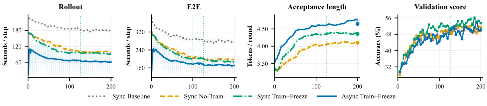
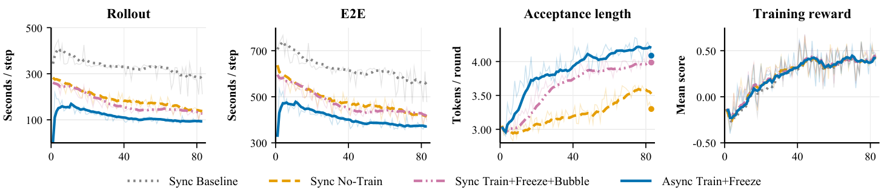

# Evaluation

Last updated: 11/18/2026

Results from *SpeCo: A Unified Training System for Speculative Drafters*,
Table 1. Experiments use Qwen3-8B, DSpark, GRPO, DAPO-Math-17k, and vLLM.
GPU runs use four GPUs for 100 RL steps; NPU runs use 16 NPUs for 200 steps.

All speedups are relative to the synchronous non-speculative baseline on the
same platform. E2E step time includes adaptation but excludes checkpoint I/O
and validation. Async rollout timing measures exposed generation waiting time.
Acceptance length is measured at the final step.

<table>
  <thead>
    <tr><th rowspan="2">Mode</th><th rowspan="2">Platform</th><th rowspan="2">Method</th><th colspan="2">Rollout</th><th colspan="2">E2E</th><th rowspan="2">Final acceptance length</th></tr>
    <tr><th>Time (s)</th><th>Speedup</th><th>Time (s)</th><th>Speedup</th></tr>
  </thead>
  <tbody>
    <tr><th rowspan="9">Sync</th><th rowspan="4">NPU</th><td>Baseline</td><td align="right">189.6</td><td align="right">1.00×</td><td align="right">294.0</td><td align="right">1.00×</td><td align="right">—</td></tr>
    <tr><td>No-Train</td><td align="right">116.1</td><td align="right">1.63×</td><td align="right">220.8</td><td align="right">1.33×</td><td align="right">4.10</td></tr>
    <tr><td>Train</td><td align="right">109.7</td><td align="right">1.73×</td><td align="right">222.1</td><td align="right">1.32×</td><td align="right"><strong>4.43</strong></td></tr>
    <tr><td>Train+Freeze</td><td align="right"><strong>106.4</strong></td><td align="right"><strong>1.78×</strong></td><td align="right"><strong>213.8</strong></td><td align="right"><strong>1.38×</strong></td><td align="right">4.36</td></tr>
    <tr><th rowspan="5">GPU</th><td>Baseline</td><td align="right">320.1</td><td align="right">1.00×</td><td align="right">607.4</td><td align="right">1.00×</td><td align="right">—</td></tr>
    <tr><td>No-Train</td><td align="right">178.6</td><td align="right">1.79×</td><td align="right">467.8</td><td align="right">1.30×</td><td align="right">3.30</td></tr>
    <tr><td>Train</td><td align="right">170.7</td><td align="right">1.87×</td><td align="right">464.4</td><td align="right">1.31×</td><td align="right">3.40</td></tr>
    <tr><td>Train+Freeze</td><td align="right">176.9</td><td align="right">1.81×</td><td align="right">475.1</td><td align="right">1.28×</td><td align="right">3.78</td></tr>
    <tr><td>Train+Freeze+Bubble</td><td align="right"><strong>162.6</strong></td><td align="right"><strong>1.97×</strong></td><td align="right"><strong>458.9</strong></td><td align="right"><strong>1.32×</strong></td><td align="right"><strong>3.93</strong></td></tr>
  </tbody>
  <tbody>
    <tr><th rowspan="4">Async</th><th rowspan="2">NPU</th><td>Baseline</td><td align="right">109.6</td><td align="right">1.73×</td><td align="right">214.9</td><td align="right">1.37×</td><td align="right">—</td></tr>
    <tr><td>Train+Freeze</td><td align="right"><strong>70.8</strong></td><td align="right"><strong>2.68×</strong></td><td align="right"><strong>186.0</strong></td><td align="right"><strong>1.58×</strong></td><td align="right"><strong>4.65</strong></td></tr>
    <tr><th rowspan="2">GPU</th><td>Baseline</td><td align="right">217.6</td><td align="right">1.47×</td><td align="right">511.4</td><td align="right">1.19×</td><td align="right">—</td></tr>
    <tr><td>Train+Freeze</td><td align="right"><strong>114.3</strong></td><td align="right"><strong>2.80×</strong></td><td align="right"><strong>404.3</strong></td><td align="right"><strong>1.50×</strong></td><td align="right"><strong>4.09</strong></td></tr>
  </tbody>
</table>

Async Train+Freeze combines asynchronous scheduling, speculation, and online
adaptation. No async No-Train experiment isolates adaptation's contribution.
These are single-run results, not guarantees for other configurations.

## Bubble Time

Both GPU configurations complete 460 optimizer steps. Bubble Time runs 225
steps in idle windows (48.9%) and 235 through fallback. Exposed synchronous
drafter overhead falls from 303.75 s to 194.36 s (36.0%); mean E2E step time
falls from 475.1 s to 458.9 s (3.4%). The E2E change also includes rollout-time
changes. Bubble Time is evaluated only in synchronous GPU execution here.

## Standalone Training

SpeCo's average acceptance lengths after three training epochs (paper Table 2):

| Platform | GSM8K | HumanEval | AIME 2025 | MT-Bench | Magpie |
| --- | ---: | ---: | ---: | ---: | ---: |
| GPU | 5.80 | 4.73 | 4.89 | 3.12 | 2.74 |
| NPU | 5.82 | 4.81 | 4.90 | 3.12 | 2.94 |

These fixed-target measurements are separate from online RL speedups.
