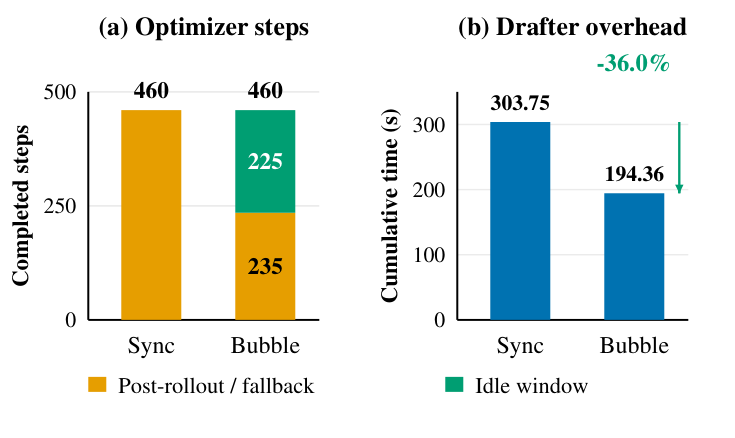

# Paper Evaluation

Last updated: 11/18/2026

Results from *SpeCo: A Unified Training System for Speculative Drafters*,
Table 1. Experiments use Qwen3-8B, DSpark, GRPO, DAPO-Math-17k, and vLLM.
GPU runs use four GPUs for 100 RL steps; NPU runs use 16 NPUs for 200 steps.

All speedups are relative to the synchronous non-speculative baseline on the
same platform. E2E step time includes adaptation but excludes checkpoint I/O
and validation. Async rollout timing measures exposed generation waiting time.
Acceptance length is measured at the final step.

| Mode | Platform | Method | Rollout time (s) | Rollout speedup | E2E step time (s) | E2E speedup | Final acceptance length |
| --- | --- | --- | ---: | ---: | ---: | ---: | ---: |
| Sync | NPU | Baseline | 189.6 | 1.00× | 294.0 | 1.00× | — |
| Sync | NPU | No-Train | 116.1 | 1.63× | 220.8 | 1.33× | 4.10 |
| Sync | NPU | Train | 109.7 | 1.73× | 222.1 | 1.32× | 4.43 |
| Sync | NPU | Train+Freeze | 106.4 | 1.78× | 213.8 | 1.38× | 4.36 |
| Sync | GPU | Baseline | 320.1 | 1.00× | 607.4 | 1.00× | — |
| Sync | GPU | No-Train | 178.6 | 1.79× | 467.8 | 1.30× | 3.30 |
| Sync | GPU | Train | 170.7 | 1.87× | 464.4 | 1.31× | 3.40 |
| Sync | GPU | Train+Freeze | 176.9 | 1.81× | 475.1 | 1.28× | 3.78 |
| Sync | GPU | Train+Freeze+Bubble | 162.6 | 1.97× | 458.9 | 1.32× | 3.93 |
| Async | NPU | Baseline | 109.6 | 1.73× | 214.9 | 1.37× | — |
| Async | NPU | Train+Freeze | 70.8 | 2.68× | 186.0 | 1.58× | 4.65 |
| Async | GPU | Baseline | 217.6 | 1.47× | 511.4 | 1.19× | — |
| Async | GPU | Train+Freeze | 114.3 | 2.80× | 404.3 | 1.50× | 4.09 |

Async Train+Freeze combines asynchronous scheduling, speculation, and online
adaptation. No async No-Train experiment isolates adaptation's contribution.
These are single-run results, not guarantees for other configurations.

## Bubble Time

Both GPU configurations complete 460 optimizer steps. Bubble Time runs 225
steps in idle windows (48.9%) and 235 through fallback. Exposed synchronous
drafter overhead falls from 303.75 s to 194.36 s (36.0%); mean E2E step time
falls from 475.1 s to 458.9 s (3.4%). The E2E change also includes rollout-time
changes. Bubble Time is evaluated only in synchronous GPU execution here.

## Standalone Training

SpeCo's average acceptance lengths after three training epochs (paper Table 2):

| Platform | GSM8K | HumanEval | AIME 2025 | MT-Bench | Magpie |
| --- | ---: | ---: | ---: | ---: | ---: |
| GPU | 5.80 | 4.73 | 4.89 | 3.12 | 2.74 |
| NPU | 5.82 | 4.81 | 4.90 | 3.12 | 2.94 |

These fixed-target measurements are separate from online RL speedups.
